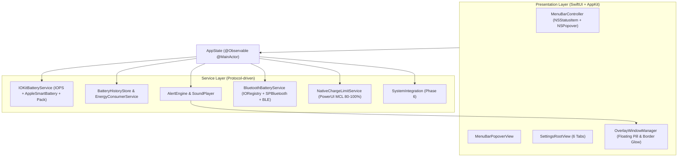

# Kiến trúc hệ thống Powerman

## 1. Tổng quan kiến trúc

Powerman sử dụng mô hình **Modular MVVM + Service Layer** trên macOS (`SwiftUI` + `AppKit` bridge), với `AppState` (`@Observable @MainActor`) làm nguồn chân lý duy nhất (Single Source of Truth) cho toàn bộ UI (Menu Bar icon, Popover, Settings Window, Overlay Windows).



## 2. Cấu trúc thư mục

```text
powerman/
├── Powerman.xcodeproj
├── Powerman/
│   ├── App/
│   │   ├── PowermanApp.swift          # @main entry point & Settings Scene
│   │   ├── AppDelegate.swift          # Khởi tạo MenuBarController & vòng đời nền
│   │   └── AppState.swift             # State trung tâm, đồng bộ Service -> UI
│   ├── Models/
│   │   ├── BatteryInfo.swift          # Dữ liệu pin chuẩn hóa từ IOKit
│   │   └── AppSettings.swift          # Cấu hình MenuBar, Appearance, Language
│   ├── Services/
│   │   └── Battery/
│   │       └── IOKitBatteryService.swift # Đọc IOPS + AppleSmartBattery + IOPS Notification
│   ├── UI/
│   │   ├── MenuBar/
│   │   │   ├── MenuBarController.swift    # NSStatusItem renderer & NSPopover
│   │   │   └── MenuBarPopoverView.swift   # Popover dropdown chính
│   │   └── Settings/
│   │       ├── SettingsRootView.swift     # Sidebar navigation & cửa sổ Settings
│   │       ├── MenuBarSettingsView.swift  # Cấu hình kiểu Menu Bar + Live Preview
│   │       └── BatteryOverviewView.swift  # Hiển thị thông số pin hiện tại (mở rộng ở Phase 4)
│   └── Resources/
│       ├── Info.plist                 # LSUIElement = YES
│       └── Powerman.entitlements      # App Sandbox = NO
├── PowermanTests/
│   └── BatteryInfoTests.swift         # Unit tests cho parser IOKit & Settings
├── docs/
│   ├── ARCHITECTURE.md
│   └── PROGRESS.md
├── .github/workflows/ci.yml
├── AGENTS.md
├── CHANGELOG.md
├── CONTRIBUTING.md
└── README.md
```

## 3. Quyết định kiến trúc (Architecture Decision Records - ADRs)

### ADR-001: Tắt App Sandbox (`com.apple.security.app-sandbox = false`)
- **Bối cảnh:** Powerman cần đọc các khóa phần cứng từ `AppleSmartBattery` trong `IORegistry`, truy vấn thiết bị Bluetooth HID, hiển thị cửa sổ overlay toàn màn hình, và can thiệp `Charge Limit` / `Accessibility`.
- **Quyết định:** Phân phối trực tiếp ngoài Mac App Store với App Sandbox tắt.
- **Hệ quả:** Cần ký mã (Developer ID) & Notarize khi phát hành bản production; không đưa lên Mac App Store.

### ADR-002: Menu Bar bằng AppKit (`NSStatusItem` + `NSPopover`) thay vì chỉ `MenuBarExtra`
- **Bối cảnh:** Người dùng cần chuyển đổi linh hoạt giữa 3 kiểu icon (`Battery Indicator`, `Minimal`, `Powerman Logo`), thay đổi kích thước, màu trạng thái động và gắn thêm % pin của nhiều thiết bị Bluetooth trực tiếp lên thanh Menu Bar.
- **Quyết định:** Dùng `NSStatusItem` quản lý bởi `MenuBarController` kết hợp render ảnh/view SwiftUI sắc nét theo DPI (`NSHostingView` / `ImageRenderer`) và `NSPopover` chứa `MenuBarPopoverView`.
- **Hệ quả:** Kiểm soát hoàn toàn layout, kích thước, màu sắc và không bị giới hạn bởi `MenuBarExtra` mặc định của SwiftUI.

### ADR-003: Chuẩn hóa dữ liệu IOKit qua `BatterySnapshotParser` thuần Swift
- **Bối cảnh:** `AppleSmartBattery` trả về từ điển `CFDictionary` không đồng nhất giữa các đời Mac (ví dụ `Temperature` đơn vị `0.01 K`, `InstantAmperage` có thể là số nguyên 64-bit biểu diễn bù 2, `AppleRawMaxCapacity` vs `MaxCapacity`).
- **Quyết định:** Tách logic chuyển đổi từ `[String: Any]` sang `BatteryInfo` thành `BatterySnapshotParser` thuần (pure functions) để có thể unit test 100% không cần phần cứng thật.

### ADR-004: Lộ trình Charge Limit (Phase 5) ưu tiên Native macOS trước SMC Helper
- **Bối cảnh:** Trên macOS mới (Apple Silicon), hệ điều hành có cơ chế Charge Limit tích hợp.
- **Quyết định:** Phase 5 sẽ kiểm chứng API/CLI native Charge Limit của macOS trước; chỉ triển khai thêm `SMAppService.daemon` (Privileged Helper SMC) nếu native API không cho phép điều chỉnh ngưỡng 80–100% từ user space.
